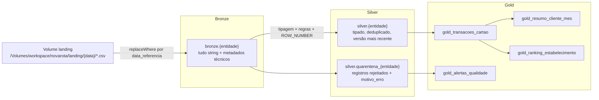

# Pipeline incremental de movimentações de cartão - Cooperativa NovaRota

Pipeline em Databricks com Delta Lake que ingere arquivos diários de clientes, contas, cartões, transações e estornos, trata problemas de qualidade e duplicidade e gera tabelas analíticas nas camadas Bronze, Silver e Gold.

Os dados são fictícios, gerados com Faker a partir de uma seed fixa. Nenhuma credencial ou dado real está no repositório.

## Sumário

- [Arquitetura](#arquitetura)
- [Estrutura do repositório](#estrutura-do-repositório)
- [Como executar](#como-executar)
- [Massa de dados](#massa-de-dados)
- [Camadas](#camadas)
- [Consultas SQL](#consultas-sql)
- [Decisões técnicas](#decisões-técnicas)
- [Testes e validações](#testes-e-validações)
- [Evidências de execução](#evidências-de-execução)
- [Premissas](#premissas)
- [Limitações](#limitações)
- [Próximos passos](#próximos-passos)

## Arquitetura



Cada execução recebe uma `data_referencia`:

1. **Bronze** lê os CSVs de `landing/<data_referencia>/` e grava uma tabela Delta por entidade, sem regra de negócio. Reprocessar a mesma data substitui apenas aquela carga.
2. **Silver** lê da Bronze apenas a `data_referencia` da execução, tipa os campos, aplica as regras de qualidade, separa os rejeitados em quarentena, deduplica pela chave de negócio e faz `MERGE` nas tabelas finais. A ordem é clientes → contas → cartões → transações → estornos, porque cada entidade valida a integridade referencial contra a tabela Silver já atualizada da entidade pai.
3. **Gold** é recalculada a partir da Silver depois de todas as cargas do dia.

## Estrutura do repositório

```
src/
  config.py                    ambiente (local/databricks), caminhos, nomes de tabelas
  datagen/generator.py         geração da massa fictícia com Faker
  ingestion/bronze.py          leitura da landing e escrita na Bronze
  quality/cpf.py               validação de CPF
  quality/rules.py             regras de qualidade por entidade
  transformations/silver.py    tipagem, quarentena, deduplicação, MERGE, estornos
  transformations/gold.py      execução dos SQLs da Gold
  utils/spark.py               sessão Spark, criação de schemas, execução de arquivos SQL
  utils/logging.py             logger e medição de tempo por etapa
sql/
  gold/                        uma tabela Gold por arquivo (CREATE OR REPLACE TABLE ... AS SELECT)
  analises/                    consultas analíticas pedidas no desafio
  validacao_silver.sql         invariantes da Silver
notebooks/                     orquestração no Databricks (00_setup a 04_analises_sql)
scripts/
  generate_data.py             gera a massa localmente
  run_pipeline.py              roda Bronze, Silver e Gold localmente
tests/                         testes com pytest e Spark local
docs/evidencias/               notebooks executados no Databricks, exportados em HTML
```

Toda a lógica fica em `src/` e `sql/`. Os notebooks só recebem parâmetros, chamam essas funções e exibem os resultados, então o mesmo código roda no Databricks e nos testes locais.

## Como executar

### Databricks (Free Edition)

1. Em **Settings → Linked accounts**, vincule a conta do GitHub.
2. Em **Workspace → Create → Git folder**, clone este repositório e selecione a branch `main`.
3. Conecte os notebooks ao compute **Serverless** e execute na ordem:

| Notebook | Parâmetros | O que faz |
|---|---|---|
| `notebooks/00_setup` | `start_date=2026-10-01`, `days=3`, `seed=42` | Cria os schemas `bronze`, `silver`, `gold`, o Volume `novarota.landing` e gera a massa no Volume |
| `notebooks/01_bronze` | `data_referencia` | Ingestão de uma data |
| `notebooks/02_silver` | `data_referencia` | Silver de uma data, com validações ao final |
| `notebooks/03_gold` | - | Recalcula as quatro tabelas Gold e concilia os valores |
| `notebooks/04_analises_sql` | - | Executa as consultas de `sql/analises` |

Para cada data (`2026-10-01`, `2026-10-02` e `2026-10-03`, nessa ordem), rode `01_bronze` e depois `02_silver`. Em seguida, rode `03_gold` e `04_analises_sql` uma vez.

O ambiente é detectado pela variável `DATABRICKS_RUNTIME_VERSION`. Nenhum notebook precisa de configuração manual de caminho ou catálogo. O catálogo padrão é `workspace` e pode ser alterado pela variável de ambiente `CATALOG`.

### Local

Requisitos: Python 3.11 e Java 17.

```bash
python -m venv .venv && source .venv/bin/activate
pip install -r requirements-dev.txt
export JAVA_HOME=<caminho do Java 17>

python -m scripts.generate_data --clean
python -m scripts.run_pipeline --dates 2026-10-01 2026-10-02 2026-10-03
python -m pytest
```

Localmente, as tabelas ficam em `lakehouse/` (metastore Derby + arquivos Delta) e a landing em `data/landing/`, ambas fora do controle de versão. A suíte de testes leva cerca de 3 minutos, porque `tests/test_silver.py` executa o pipeline completo.

## Massa de dados

O gerador (`src/datagen/generator.py`) cria uma pasta por dia de carga:

- **01/10** é a carga inicial: 150 clientes, contas e cartões, e transações desde 01/08, para que existam meses completos nas análises mensais.
- **02/10 e 03/10** são cargas incrementais: 15 clientes novos (com conta e cartão ativos), 15 clientes com cadastro atualizado, 10 contas bloqueadas ou encerradas, 10 cartões cancelados, as transações do dia e 10 transações atrasadas, com data de 1 a 3 dias antes da carga.

Os registros válidos respeitam as relações entre as entidades:

- o status do cartão acompanha o da conta: conta bloqueada tem cartões bloqueados e conta encerrada tem cartões cancelados. Quando uma conta muda de status, os cartões ativos dela são atualizados na mesma carga;
- transações só acontecem em cartões ativos, a partir da data de emissão;
- estornos têm data igual ou posterior à da transação;
- o cartão é emitido depois da abertura da conta, e o cliente tem pelo menos 18 anos na abertura;
- cada nome de estabelecimento corresponde a um único estabelecimento (cidade e MCC).

Essas relações são verificadas em `tests/test_generator.py`.

O ruído é sempre uma cópia de um registro válido com um campo alterado. Assim os registros válidos ficam intactos e é possível saber exatamente o que deveria ir para a quarentena. A taxa de ruído é configurável por arquivo (`--noise contas=0.10`).

| Arquivo | Taxa padrão | Ruído injetado |
|---|---|---|
| clientes.csv | 10% | CPF inválido, versão antiga do mesmo cliente, duplicata exata |
| contas.csv | 10% | conta sem cliente, status fora do domínio, duplicata exata |
| cartoes.csv | 5% | cartão sem conta, duplicata exata |
| transacoes_cartao_YYYYMMDD.csv | 5% | valor negativo, data inválida, cartão inexistente, duplicata exata |
| estornos.csv | 20% | estorno de transação inexistente, duplicata exata |

Cartões cancelados e transações atrasadas não são ruído: são situações válidas que o pipeline precisa aceitar.

Cada pasta tem um `_manifest.json` com a quantidade de registros válidos e de cada tipo de ruído. Ele é usado nos testes para conferir se a quarentena da Silver bate com o que foi gerado.

## Camadas

### Bronze

- Todos os campos são lidos como `string` (`inferSchema=false`). Uma data como `31/13/2026` chega intacta e o erro é tratado na Silver, em vez de virar `null` silenciosamente na leitura.
- Metadados técnicos: `arquivo_origem` (`_metadata.file_path`), `data_referencia`, `timestamp_ingestao` e `hash_linha`.
- `hash_linha` é um SHA-256 das colunas de negócio, com um marcador para `null` (sem ele, `("a", null, "b")` e `("a", "b", null)` gerariam o mesmo hash). As colunas técnicas ficam fora do hash, então a mesma linha recebida em dias diferentes tem o mesmo hash.
- Escrita com `replaceWhere data_referencia = '<data>'`: reprocessar uma data substitui apenas aquela carga, e as versões anteriores continuam disponíveis no histórico Delta (`DESCRIBE HISTORY`, `VERSION AS OF`).

### Silver

**Tipagem.** Feita com `try_cast` e `try_to_timestamp`. No Databricks serverless o modo ANSI vem ligado e um `CAST` comum de um valor inválido interrompe o job. Com as funções `try_`, o valor inválido vira `null` e é capturado pela regra de qualidade correspondente. Também há padronização: `trim`, `upper` em códigos e status, e CPF apenas com dígitos.

**Regras de qualidade** (`src/quality/rules.py`):

| Entidade | Motivos de rejeição |
|---|---|
| clientes | `ID_INVALIDO`, `CPF_INVALIDO`, `DATA_NASCIMENTO_INVALIDA`, `DATA_ATUALIZACAO_INVALIDA` |
| contas | `ID_INVALIDO`, `STATUS_INVALIDO`, `DATA_ABERTURA_INVALIDA`, `CLIENTE_INEXISTENTE` |
| cartoes | `ID_INVALIDO`, `STATUS_INVALIDO`, `DATA_ATUALIZACAO_INVALIDA`, `CONTA_INEXISTENTE` |
| transacoes_cartao | `ID_INVALIDO`, `VALOR_INVALIDO`, `VALOR_NEGATIVO`, `DATA_TRANSACAO_INVALIDA`, `CARTAO_INEXISTENTE`, `DATA_ANTERIOR_EMISSAO_CARTAO` |
| estornos | `ID_INVALIDO`, `DATA_ESTORNO_INVALIDA`, `TRANSACAO_INEXISTENTE`, `DATA_ANTERIOR_TRANSACAO` |

Um registro com mais de um problema recebe todos os motivos, separados por `;`.

As regras de integridade referencial também trazem colunas da entidade pai, o que permite validar a coerência temporal: uma transação não pode ser anterior à emissão do cartão, e um estorno não pode ser anterior à transação. A massa gerada não tem esses casos, mas a regra existe para dados de origem que tenham.

**Quarentena.** Uma tabela por entidade (`silver.quarentena_<entidade>`) com os valores originais em texto, os metadados da Bronze e o `motivo_erro`. Guardar o valor original é o que permite investigar o problema depois. A escrita usa `replaceWhere` por data, como na Bronze.

**Deduplicação.** Entre os registros válidos:

```
ROW_NUMBER() OVER (PARTITION BY <chave> ORDER BY data_atualizacao DESC, timestamp_ingestao DESC, hash_linha DESC)
```

Fica a linha com `ROW_NUMBER = 1`. As demais vão para a quarentena como `REGISTRO_DUPLICADO` (mesmo `hash_linha` da linha mantida) ou `VERSAO_DESATUALIZADA` (conteúdo diferente, versão mais antiga). Contas não têm `data_atualizacao`, então a ordenação usa `data_referencia`. Transações e estornos usam `timestamp_ingestao`.

**MERGE.**

| Tabela | Condição |
|---|---|
| clientes, cartoes | `WHEN MATCHED AND s.data_atualizacao > t.data_atualizacao THEN UPDATE` / `WHEN NOT MATCHED THEN INSERT` |
| contas | `WHEN MATCHED AND s.data_referencia >= t.data_referencia THEN UPDATE` / `WHEN NOT MATCHED THEN INSERT` |
| transacoes_cartao, estornos | apenas `WHEN NOT MATCHED THEN INSERT` |

A condição de update impede que uma versão antiga, chegando atrasada, sobrescreva uma mais nova. Transações são imutáveis: uma transação reenviada é ignorada e uma atrasada entra normalmente, porque a chave é o `id_transacao` e não a data.

**Estornos.** A tabela `silver.transacoes_cartao` tem a coluna `estornada`, atualizada por um segundo `MERGE` a partir de `silver.estornos`. Como o estorno pode chegar dias depois da transação, a marcação acontece a cada carga, e não apenas quando a transação é inserida.

### Gold

Recalculada a partir da Silver com `CREATE OR REPLACE TABLE ... AS SELECT` (arquivos em `sql/gold/`).

| Tabela | Grão | Conteúdo |
|---|---|---|
| `gold_transacoes_cartao` | transação | transação + cartão + conta + cliente, `estornada` e `valor_liquido` (zero quando estornada). Sem CPF |
| `gold_resumo_cliente_mes` | cliente × mês | quantidade, valor total e ticket médio das transações não estornadas, quantidade e valor estornado, estabelecimentos distintos |
| `gold_ranking_estabelecimento` | estabelecimento × mês | quantidade, valor, ticket médio, clientes distintos, `DENSE_RANK` por valor e por quantidade |
| `gold_alertas_qualidade` | data × entidade × motivo | registros rejeitados, total lido na Bronze e percentual |

As transações estornadas continuam na visão analítica para consulta, mas nenhum indicador financeiro as considera. O notebook `03_gold` termina com uma conciliação: a soma do resumo mensal, a soma do ranking e a soma das transações não estornadas precisam ser iguais.

## Consultas SQL

Todas usam CTEs e estão em `sql/analises/`.

| Arquivo | Requisito |
|---|---|
| `01_versao_mais_recente_cliente.sql` | `ROW_NUMBER` para selecionar a versão mais recente do cadastro |
| `02_variacao_mensal_cliente.sql` | `LAG` e `LEAD` para comparar a movimentação entre meses |
| `03_ranking_clientes_por_estado.sql` | `RANK` por estado e `DENSE_RANK` geral |
| `04_clientes_crescimento_acima_50.sql` | clientes com crescimento superior a 50% entre dois meses consecutivos |
| `05_quartis_valor_movimentado.sql` | `NTILE(4)` sobre o valor movimentado |

Na consulta de crescimento, o `LAG` devolve o último mês em que o cliente teve movimento, que nem sempre é o mês imediatamente anterior. Por isso a consulta exige `mes_anterior = add_months(ano_mes, -1)`. Sem essa condição, um cliente sem movimento em setembro teria outubro comparado com agosto. Meses com valor anterior igual a zero também ficam de fora, para não dividir por zero.

O ranking foi feito por estado, e não por cidade, porque as cidades geradas pelo Faker são praticamente únicas e cada cidade teria um único cliente.

## Decisões técnicas

**Carga incremental.** A Bronze e a quarentena usam `replaceWhere` por `data_referencia`. A Silver processa apenas a fatia da data e grava com `MERGE` pela chave de negócio. Reprocessar qualquer data não duplica registros: isso é coberto por teste e pode ser visto no histórico Delta das evidências.

**Gold recalculada inteira.** Uma transação atrasada ou um estorno que chega hoje alteram indicadores de meses anteriores. Recalcular a Gold a partir da Silver garante consistência e, com esse volume, leva poucos segundos. Com volume maior, a alternativa seria recalcular apenas os meses afetados pela carga (`replaceWhere ano_mes IN (...)`).

**Particionamento.** Nenhuma tabela foi particionada. O volume é de poucos milhares de linhas, e particionar por data geraria muitos arquivos pequenos sem ganho de leitura. O `replaceWhere` funciona sem partição. Em produção, eu avaliaria Liquid Clustering (`CLUSTER BY`) por `data_referencia` na Bronze e por `id_cliente`/`data_transacao` na Silver e na Gold, que se adapta ao padrão de consulta sem o problema de partições pequenas.

**Schema evolution.**
- Bronze: escrita com `mergeSchema=true`. Se a origem passar a enviar uma coluna nova, ela é incorporada à tabela sem quebrar a carga.
- Silver: o schema é um contrato explícito (`EntitySpec` em `src/transformations/silver.py`). Uma coluna nova na Bronze é ignorada até ser adicionada ao contrato, o que evita que mudanças na origem cheguem às camadas de consumo sem revisão. Para incorporar, basta incluir a coluna no `EntitySpec` e adicioná-la à tabela (`ALTER TABLE ... ADD COLUMN` ou `MERGE` com `schema.autoMerge` habilitado nessa execução).
- Gold: recriada a cada execução, então acompanha qualquer mudança nos SQLs.

**MERGE em SQL.** O `MERGE` é executado com `spark.sql` sobre uma temp view, em vez da API `DeltaTable` do Python. Funciona da mesma forma no Spark local e no serverless (Spark Connect) e fica legível para quem conhece SQL.

**Gold em SQL.** As transformações da Gold são joins e agregações, mais fáceis de ler e revisar em SQL. O Python (`build_gold`) só executa os arquivos em ordem.

**Validação de CPF como UDF.** A regra reaproveita a função `is_valid_cpf`, que tem testes próprios. Uma UDF Python processa linha a linha. Para um volume maior, eu trocaria por `pandas_udf` ou pelo cálculo dos dígitos verificadores em expressões nativas do Spark.

**CPF fora da Gold.** A Gold é a camada consumida pelas áreas de negócio, que não precisam do CPF para os indicadores.

## Testes e validações

77 testes com pytest e Spark local (`tests/`):

| Arquivo | O que cobre |
|---|---|
| `test_config.py` | detecção de ambiente e nomes de tabelas |
| `test_generator.py` | reprodutibilidade da massa, taxa de ruído, histórico, transações atrasadas e coerência entre entidades (datas de emissão, transação e estorno, status de cartão e conta, idade do cliente) |
| `test_bronze.py` | leitura como string, metadados, hash, reprocessamento sem duplicar, arquivo ausente |
| `test_quality_rules.py` | CPF, tipagem com ANSI ligado, padronização, cada motivo de rejeição (incluindo transação anterior à emissão e estorno anterior à transação), valor original preservado |
| `test_dedup.py` | versão mais recente, duplicata exata vs. versão desatualizada, desempate |
| `test_silver.py` | pipeline completo: quarentena igual ao manifest em todas as entidades e datas, chave única, estornos, reprocessamento, versão antiga atrasada |
| `test_gold_metrics.py` | estornos fora dos indicadores, ticket médio, conciliação, empate no `DENSE_RANK`, alertas com múltiplos motivos |
| `test_sql_analytics.py` | crescimento só entre meses consecutivos, `LAG`/`LEAD`, `NTILE`, `RANK` vs `DENSE_RANK`, `ROW_NUMBER` |

O teste mais importante é a comparação da quarentena com o `_manifest.json`. O gerador registra o que injetou sem conhecer as regras da Silver, e a Silver detecta os problemas sem olhar o manifest. As contagens precisam bater por motivo, entidade e data.

Além dos testes, `sql/validacao_silver.sql` verifica 18 invariantes da Silver (chave única, integridade referencial, ausência de valores inválidos, coerência entre datas de emissão, transação e estorno, versão mais recente recalculada a partir da Bronze e consistência dos estornos). O notebook `02_silver` executa essas validações e falha se alguma tiver violação.

## Evidências de execução

Execução no Databricks Free Edition (serverless) com as cargas de 01/10, 02/10 e 03/10, além do reprocessamento de 01/10 depois das demais cargas para verificar a idempotência.

O guia [docs/evidencias/README.md](docs/evidencias/README.md) mostra a sequência executada, com horários extraídos do histórico Delta, e explica como ler cada arquivo. As principais saídas foram exportadas em CSV e podem ser abertas diretamente no GitHub:

| Evidência | O que mostra |
|---|---|
| [Bronze: registros por data](docs/evidencias/csv/01_bronze_contagem_por_data.csv) | volume ingerido por entidade e `data_referencia` |
| [Bronze: histórico Delta](docs/evidencias/csv/01_bronze_historico_transacoes.csv) | uma escrita por carga e o reprocessamento de 01/10, que removeu e regravou as mesmas 2604 linhas, sem duplicar |
| [Silver: histórico do MERGE de clientes](docs/evidencias/csv/02_silver_historico_merge_clientes.csv) | inserções e atualizações em cada carga incremental; o reprocessamento de 01/10 depois de 03/10 não inseriu nem atualizou nenhum cliente |
| [Silver: validações](docs/evidencias/csv/02_silver_validacoes.csv) | as 18 invariantes de `sql/validacao_silver.sql`, todas sem violação |
| [Gold: alertas de qualidade](docs/evidencias/csv/03_gold_alertas_qualidade.csv) | registros rejeitados por data, entidade e motivo, com o percentual sobre o total lido |
| [Gold: ranking de estabelecimentos](docs/evidencias/csv/03_gold_ranking_top5.csv) | cinco maiores estabelecimentos por mês, com `DENSE_RANK` por valor e por quantidade |
| [Gold: conciliação](docs/evidencias/csv/03_gold_conciliacao.csv) | resumo mensal, ranking e transações não estornadas com o mesmo total (R$ 1.016.324,87); os R$ 10.507,44 estornados ficam fora dos indicadores |
| [Análise: crescimento acima de 50%](docs/evidencias/csv/04_crescimento_acima_50.csv) | 26 clientes com crescimento superior a 50% entre meses consecutivos |
| [Análise: quartis](docs/evidencias/csv/04_quartis_resumo.csv) | quantidade de clientes e valor movimentado em cada quartil |

Os notebooks completos, com todas as células executadas, estão em `docs/evidencias/*.html`. O GitHub não renderiza esses arquivos: para visualizá-los, é preciso baixar e abrir no navegador.

## Premissas

- Cada pasta da landing corresponde a uma `data_referencia` e contém no máximo um arquivo por entidade. Um arquivo ausente é registrado em log e a carga das demais entidades continua.
- `data_atualizacao` define a versão mais recente de clientes e cartões. Em caso de empate dentro de uma mesma carga, vale o registro ingerido por último. Entre cargas diferentes, a versão já gravada só é substituída por outra com `data_atualizacao` maior.
- Contas não têm `data_atualizacao` no layout. A versão mais recente é a do arquivo com maior `data_referencia`.
- Transações e estornos são imutáveis: o primeiro registro recebido de cada id é o que vale.
- Uma transação é considerada estornada se existir ao menos um estorno válido para ela. Estornos parciais não foram modelados.
- Valor zero é aceito. Apenas valores negativos são rejeitados.
- Os campos obrigatórios são os do layout do desafio. Campos obrigatórios nulos ou inválidos levam o registro à quarentena.

## Limitações

- **Registro filho antes do pai.** Um estorno de uma transação que ainda não chegou, ou uma transação de um cartão ainda não cadastrado, vai para a quarentena como órfão e não é reprocessado automaticamente quando o pai chega.
- **Sem histórico de cadastro.** A Silver guarda apenas a versão atual (SCD tipo 1). Na Gold, uma transação antiga aparece com a cidade atual do cliente, e não com a cidade da época.
- **Gold recalculada inteira** a cada execução, o que não escala para volumes grandes.
- **Orquestração manual.** Os notebooks são executados em sequência, sem um Job com dependências e parâmetros.
- **Alertas por motivo.** Em `gold_alertas_qualidade`, um registro com dois motivos é contado nos dois. A soma por motivo pode ser maior que o total de registros rejeitados.
- **Mês corrente parcial.** Outubro tem apenas três dias de dados, então as comparações de setembro para outubro mostram queda para quase todos os clientes.
- **Dados gerados.** As cidades do Faker são fictícias e não têm relação com a UF do cliente.
- **Coerência de status entre entidades.** A Silver valida datas entre cartão, transação e estorno, mas não valida combinações de status entre entidades (por exemplo, um cartão ativo em uma conta encerrada). A massa gerada não tem esse caso; com dados reais, seria um alerta de qualidade adicional.

## Próximos passos

- Reprocessar a quarentena de integridade referencial quando o registro pai chegar, devolvendo à Silver os registros que passam a ser válidos.
- Manter histórico de clientes e cartões com SCD tipo 2 e usar a versão vigente na data da transação na Gold.
- Criar um Job (Lakeflow Jobs / Databricks Asset Bundles) com as tarefas Bronze → Silver → Gold, parâmetro de data e retentativas.
- Recalcular na Gold apenas os meses afetados por cada carga.
- Substituir a leitura em lote da landing por Auto Loader, que controla quais arquivos já foram processados.
- Declarar as regras de qualidade como expectations (Lakeflow Declarative Pipelines) ou `CHECK` constraints do Delta.
- Aplicar máscara de coluna no CPF via Unity Catalog nas tabelas Silver.
- Rodar a suíte de testes em CI (GitHub Actions) a cada pull request.
- Definir rotinas de `OPTIMIZE` e `VACUUM` ou habilitar Predictive Optimization.
